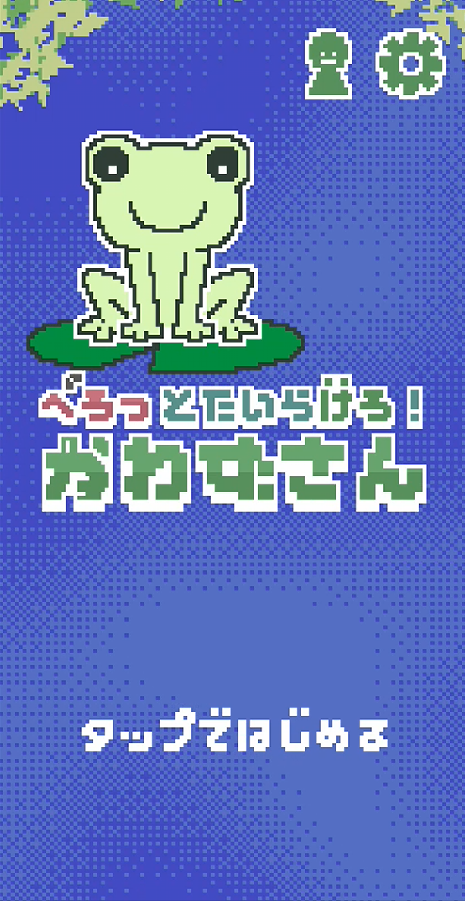
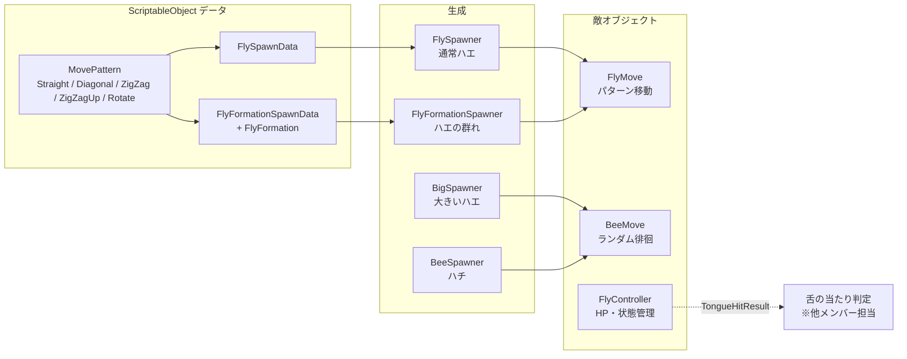

# ぺろっとたいらげろ！かわずさん

<div align="left">
  
</div>

## 目次

- [概要](#概要)
- [開発情報](#開発情報)
- [使用技術](#使用技術)
- [プレイ方法](#プレイ方法)
- [自分が担当した実装（ハエ・ハチの生成と動き）](#自分が担当した実装ハエ・ハチの生成と動き)
- [技術的な工夫](#技術的な工夫)
- [ディレクトリ構成](#ディレクトリ構成)
- [使用ライブラリ](#使用ライブラリ)

---
## 概要

カエルの「かわずさん」が舌を伸ばして飛んでくるハエを食べ、**満腹度ゲージを最大にするまでのタイムを競う** 2D アクションゲームです。

- 画面をタップすると、タップした位置に向かってかわずさんの舌が伸びます。
- 舌に当たったハエは捕まり、舌が戻ると食べられて満腹度が増えます。
- 満腹度が最大（「おなかいっぱい!」）になるとクリアで、クリアタイムが表示されます。
- 画面内を飛び回る **ハチ** に舌が当たると舌が中断され、捕まえていたハエを放してしまい、満腹度も減ります。

### ゲームの特徴

- **タップだけで遊べる操作**: 狙った位置をタップして舌を伸ばすだけのシンプルな操作です。
- **まとめぐい**: 1回の舌で3匹以上のハエをまとめて捕まえると「nひきまとめぐい！」と表示されます。
- **個性のある敵キャラクター**
  | 種類 | 内容 |
  | --- | --- |
  | ハエ（通常） | 画面の左・右・下から出現し、直線・斜め・ジグザグなどの軌道で画面を横切る |
  | 大きいハエ（コード上は `Big`／ボスハエ） | 一定間隔で出現し、画面内をランダムに飛び回る。食べると満腹度が大きく増えるが、一定時間で去っていく |
  | ハチ | 画面内を飛び回り続ける邪魔キャラ。満腹度が上がるにつれて数が増える |
  | ハエの群れ | 5匹が隊列を組んで同じ軌道で飛んでくる |
- **最速記録**: クリアタイムの最速記録が表示され、更新すると「きろくこうしん！」と表示されます。

## 開発情報

| 項目 | 内容 |
| --- | --- |
| 開発形態 | 3人チームでのチーム開発 |
| 開発期間 | 1週間（テーマ決め・素材集めの後、実装は2日間） |
| 自分の担当 | **ハエ・ハチの生成と動き**（敵キャラクターのスポーン、移動パターン、状態管理） |
| 他メンバーの担当 | ゲームシステム、UI、サウンド |

本README の「[6. 自分が担当した実装](#6-自分が担当した実装ハエハチの生成と動き)」「[7. 技術的な工夫](#7-技術的な工夫)」では、チーム全体の実装のうち **自分が担当した部分のみ** を説明しています。
舌の伸縮・当たり判定、満腹度ゲージ、UI、タイトル・リザルト、サウンドなどはチームメンバーの担当です。
またこのゲームはサイバーエージェントのインターンでの製作で元のプロジェクトのリポジトリは既に削除されてしまったのでチームメンバーは載せていません。情報公開については許可があった範囲で載せています。

## 使用技術

| 項目 | 内容 |
| --- | --- |
| ゲームエンジン | Unity 6（6000.3.22f1） |
| 言語 | C# |
| 主なパッケージ / ライブラリ | DOTween（アニメーション）、UniTask 2.5.11（非同期処理）、TextMesh Pro、Input System、2D Aseprite Importer、2D Pixel Perfect |
| 開発 OS / IDE | Windows 11 / Visual Studio |
| バージョン管理 | Git |
| 対象プラットフォーム | スマートフォン |

## プレイ方法
### プレイ動画

> [](https://www.youtube.com/watch?v=xcY2ZdJBt7E)


### 操作方法

| 操作 | 内容 |
| --- | --- |
| タップ（マウス左クリック） | タップした位置に向かって舌を伸ばす |
| タイトル画面でタップ | ゲーム開始 |
| 設定ボタン | BGM・SE の音量調整、やり直し、タイトルへ戻る |

### 実行方法（Unity エディタ）

1. Unity Hub で **Unity 6000.3.22f1** をインストールします。
2. このリポジトリをクローンします。
   ```sh
   git clone <このリポジトリのURL>
   ```
3. Unity Hub の「追加」からクローンしたフォルダを開きます。
4. `Assets/Project/Scenes/Setup.unity` を開き、再生ボタンを押します（Setup シーンから Title シーンへ遷移します）。

### ブラウザでプレイ

UnityRoomで公開しています：[こちらからプレイ](https://unityroom.com/games/flyeater_kawazu)

## 自分が担当した実装（ハエ・ハチの生成と動き）

担当した実装は `Assets/Sandbox/Imai/` 以下にまとまっています。

### 担当範囲の全体像



| ファイル | 役割 |
| --- | --- |
| `FlySpawner.cs` | 通常ハエの生成。種類を重み付き抽選し、`FlySpawnData` から出現位置・移動パターンを決定 |
| `FlyGroup/FlyGroupSpawner.cs`（`FlyFormationSpawner`） | 隊列（`FlyFormation`）に沿ってハエの群れを一度に生成 |
| `BigSpawner.cs` / `BigDespawn.cs` | 大きいハエの定期生成と、一定時間経過後の退場 |
| `Bee/BeeSpawner.cs` | ハチの初期生成と、満腹度に応じた追加生成 |
| `Bee/BeeMove.cs` | ハチ・大きいハエのランダムな徘徊移動 |
| `FlyMove.cs` | `MovePattern` に従ってハエを移動させる |
| `MovePattern/*.cs` | 移動パターンの基底クラスと各実装（直線・斜め・ジグザグ・上昇ジグザグ・回転） |
| `FlyController.cs` | HP・満腹度の値・状態（飛行中 / 捕獲中 / 食べられた / 消滅）の管理と、舌に当たったときの判定結果の返却 |
| `DespawnArea.cs` | 画面外に出たハエを消滅させるトリガー |
| `Enum/*.cs` | `FlyType`、`FlyState`、`SpawnArea`、`TongueHitResult` |

## 技術的な工夫

### 移動パターンを ScriptableObject で差し替え可能にした（Strategy パターン）

移動ロジックを抽象クラス `MovePattern`（`ScriptableObject`）として切り出し、各ハエは「どのパターンで動くか」を外から受け取るだけにしました。

```csharp
// MovePattern/MovePattern.cs
public abstract class MovePattern : ScriptableObject
{
    public float speed = 2f;
    public abstract Vector3 GetMovement(Transform fly, float time);
}
```

```csharp
// FlyMove.cs（抜粋）: 経過時間を渡して速度を受け取り、deltaTime で積分する
Vector3 movement = movePattern.GetMovement(transform, Time.time - startTime);
transform.position += movement * Time.deltaTime;
```

- `GetMovement` は「生成からの経過時間 → その瞬間の速度」を返す関数になっており、ジグザグは `Sin`、回転は `Cos/Sin` を加えるだけで表現できます。
- 速度・向き・振幅・周波数などはアセット側のパラメータなので、**コードを変えずにインスペクタ上で新しい軌道を追加・調整** できます。現在は移動パターンのアセットが 17 個（`_Fast` 版を含む）あります。
- 生成側も `FlySpawnData`（Prefab・種類・移動パターン・出現エリアの組み合わせ）として ScriptableObject にしており、通常ハエ・大きいハエ・ハチそれぞれ 9 種類の出現データを用意しています。

### シード値付き乱数による再現可能なスポーン

すべてのスポナーは `UnityEngine.Random` ではなく、シード値を指定した `System.Random` を個別に持っています。

- スポナーごとに独立した乱数列を持つため、他の処理が乱数を消費しても出現の種類・位置・間隔の順番が変わらず、**同じシードなら同じ出現パターンを再現** できます。バランス調整やバグの再現確認がしやすくなります。
- ハチ・大きいハエは、スポナーの乱数から **個体ごとのシードを発行** して `BeeMove.SetSeed()` に渡しています。個体ごとに独立した乱数で目標地点や方向転換のタイミングを決めるため、複数のハチが同じ動きにならず、かつ再現性も保てます。上下の揺れの位相も個体ごとにずらしています。

```csharp
// Bee/BeeSpawner.cs（抜粋）
int beeSeed = random.Next();
BeeMove beeMove = beeObject.GetComponent<BeeMove>();
if (beeMove != null)
{
    beeMove.SetSeed(beeSeed);
}
```

### 重み付き抽選 → 種類ごとの候補抽選の 2 段階選択

`FlySpawner` では、まずハエの種類（Normal / Big / Bee）を重みで抽選し、次にその種類の `FlySpawnData` だけを候補にしてランダムに 1 つ選びます。
出現率の調整（重み）と、出現バリエーションの追加（アセットを配列に追加するだけ）を独立して行えるようにしています。

### 満腹度に連動した難易度の上昇

`BeeSpawner` は満腹度の割合を監視し、設定した閾値を超えるたびにハチの数を増やします（Prefab の設定では、満腹度 33% で 2 匹、66% で 3 匹）。
閾値と匹数は配列（`BeeSpawnThreshold[]`）でインスペクタから調整でき、ゲーム終盤ほど邪魔が増えるようにしています。

### 状態管理と、舌との処理の受け渡しを enum で明確化

ハエは `FlyState`（`Moving` / `Captured` / `Consumed` / `Despawned`）で状態を持ち、各メソッドは想定外の状態からの遷移を無視するようにしています（例: 捕獲中でなければ `Consume()` は何もしない）。

舌の当たり判定（他メンバー担当）との間は、`FlyController.OnTongueHit()` が `TongueHitResult`（`Damage` / `Capture` / `Interrupt`）を返す形にし、**ハエ側の事情（HP・種類）は敵側で判定し、舌側は結果に応じて処理を分岐するだけ** になるよう役割を分けました。

- ハチなら `Interrupt` を返し、舌側が中断処理を行う
- 舌が中断されて放されたハエは `Release()` で飛行状態に戻り、HP を 1 にして次の一撃で再捕獲できるようにしています
- HP 制なので、複数回当てないと捕まえられないハエも Prefab の設定だけで作れます

### 大きいハエの退場タイマー

`BigDespawn` は一定時間（Prefab 設定では 8 秒）で大きいハエを退場させますが、**舌に捕まっている間はタイマーを止め**、徘徊移動（`BeeMove`）も停止します。舌から放された場合は移動を再開します。

## ディレクトリ構成

```
Assets/
├── Project/                 # 本番用アセット
│   ├── Scenes/              # Setup / Title / InGame
│   ├── Sprites/             # 背景・キャラクター・UI
│   ├── Audio/               # BGM / SE
│   ├── Animations/
│   ├── Graphics/            # マテリアル・シェーダー
│   ├── Prefabs/
│   └── Others/Fonts/
├── Sandbox/                 # メンバーごとの作業領域（実装の多くはここにあり、本番シーンから参照）
│   ├── Imai/                # ★自分の担当：ハエ・ハチの生成と動き
│   │   ├── Bee/             #   ハチのスポーン・移動、ハチ用 SpawnData
│   │   ├── FlyGroup/        #   ハエの群れ（隊列データ・スポナー）
│   │   ├── MovePattern/     #   移動パターン（スクリプト + アセット）
│   │   ├── SpawnData/       #   通常 / 大きいハエの SpawnData
│   │   ├── Enum/
│   │   └── *.cs, *.prefab   #   FlySpawner, FlyController, FlyMove など
│   ├── Yagi/                # 他メンバーの作業領域
│   └── Kitano/              # 他メンバーの作業領域
├── Scripts/                 # 入力・UI などの共通スクリプト
├── Plugins/                 # DOTween, UniTask
└── TextMesh Pro/
```

---

## 使用ライブラリ

| 名称 | 作者 | ライセンス |
| --- | --- | --- |
| [DOTween](https://dotween.demigiant.com/) | Daniele Giardini - Demigiant | [DOTween のライセンス](https://dotween.demigiant.com/license.php) に従う |
| [UniTask](https://github.com/Cysharp/UniTask) 2.5.11 | Cysharp, Inc. | MIT License |
